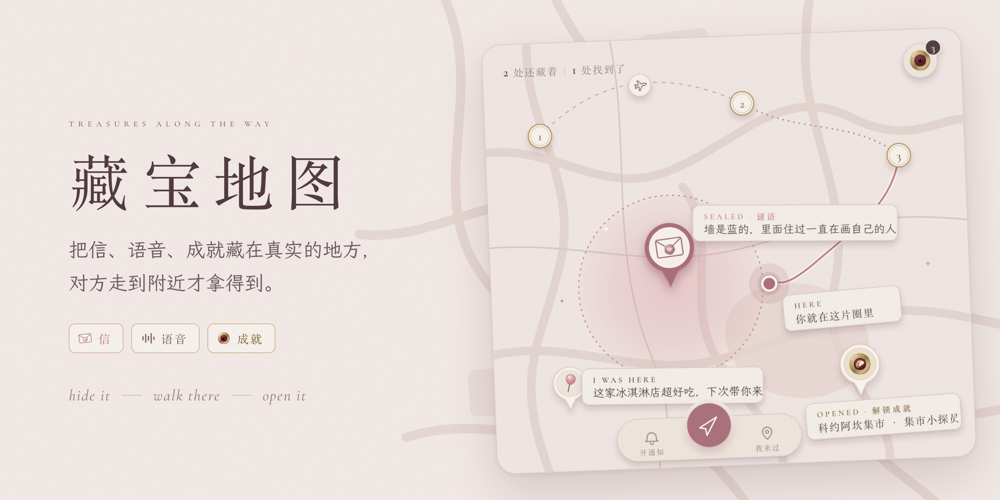

# 宝探しマップ · hidden-letters-map

[简体中文](README.md) | **日本語**

<p align="center"></p>

<p align="center"><a href="https://saekisui.github.io/hidden-letters-map/demo/"><b>スマートフォンでデモを試す ↗</b></a>（ダミーデータ。インストール不要。画面は中国語です）</p>

手紙、音声メッセージ、実績バッジを、現実の場所に隠しておけます。相手の地図に表示されるのは、ぼかした円と謎かけの一文だけ。実際にその近くまで行かないと受け取れません。

- **隠す人**：ある場所に何かを隠す、旅のルートを描く、実績を直接贈る、といった操作をします。Claude Code / Claude Desktop などの AI エージェント（MCP クライアント）に頼むか、curl で直接操作します。
- **探す人**：スマートフォンで Web ページを開きます（ホーム画面に追加すればアプリとして使えます）。地図には予定ルート、自分の現在地と足跡、霧のような円と謎かけが表示されます。円の中に入ると封筒を開けられ、開けた手紙は詳細ページで読めます。獲得した実績は実績ウォールに並び、今いる場所に「我来过」（ここに来た）のピンを立ててひと言残すこともできます。

未開封の手紙については、ページが受け取るデータに地名・座標・本文が含まれないため、開発者ツールでのぞき見ることもできません。

---

## 動かしてみる

Node 20.6 以上が必要です。

```bash
npm install
cp .env.example .env     # 少なくとも PASSWORD は変更し、2 人の呼び名も設定します
npm run build            # ページを dist/ にビルド
npm start                # デフォルトは http://localhost:3000
```

ブラウザーで開き、パスワードを入力して入ります。探す人のスマートフォンから、外部経由でこのアドレスにアクセスできる必要があります。グローバルアドレスを持つマシンに置くか、Cloudflare Tunnel / Tailscale Funnel などで自宅のマシンを外部に公開してください。**位置情報の送信とプッシュ通知には、どちらも https が必要です。**

iPhone の場合：Safari で開く → 共有 → ホーム画面に追加。ホーム画面から開いたときだけ全画面表示になり、プッシュ通知も受け取れます。

`.env` で設定できる項目：

| 変数 | 説明 |
|---|---|
| `PASSWORD` | 必須。ページへのログイン、MCP、位置情報アプリからの送信のすべてで使います |
| `PORT` | デフォルトは 3000 |
| `DATA_DIR` | データディレクトリ。デフォルトは `./data` |
| `HIDER_NAME` / `FINDER_NAME` | ページ上での 2 人の呼び名：手紙の署名「—— 阿笙」、実績バッジの周りの文字「FOR 小满 · WITH LOVE」 |
| `TZ` | 「何日訪れたら解放」の 1 日をどのタイムゾーンで数えるか。未設定の場合はシステムのタイムゾーン |
| `VAPID_PUBLIC_KEY` / `VAPID_PRIVATE_KEY` / `VAPID_SUBJECT` | プッシュ通知用（任意）。後述 |
| `GOOGLE_MAPS_API_KEY` | ストリートビュー用（任意）。後述 |

---

## 隠し方

### AI エージェントから MCP で操作する（おすすめ）

`mcp/letters-mcp.js` は stdio の MCP サーバーで、ツールは 5 つです。

| ツール | 役割 |
|---|---|
| `hide_at_place` | ある場所に何かを隠す：手紙 `letter`、音声 `voice_url` + `voice_text`、実績 `badge_*` のうち最低 1 つ。`radius_m` は何メートル以内に入れば到着とみなすか、`visits_needed` は何日訪れたら解放されるか（「ジムに 5 回」のような使い方） |
| `award_badge` | 隠さずに、実績を直接贈る |
| `add_route_stop` | ルートに立ち寄り地点を追加（日付ごと） |
| `trip_map` | 全体を確認：ルート、隠したもの、開封済みかどうか、贈った実績、相手が立てたピン |
| `remove_from_map` | 立ち寄り地点を削除／まだ見つかっていないものを回収 |

地名から座標への変換には OpenStreetMap Nominatim を使います。**住所は英語か現地の言語で、都市名まで含めて書いてください**（`Museo Frida Kahlo, Coyoacán, Mexico City`）。中国語だけの地名だと、別の国の場所がヒットすることがよくあります。間違っていた場合は `remove_from_map` で回収し、`lat` / `lon` を指定して隠し直します。

Claude Code に追加する場合：

```bash
claude mcp add letters -e LETTERS_URL=http://localhost:3000 -e LETTERS_PASSWORD=あなたのパスワード -- node /絶対パス/hidden-letters-map/mcp/letters-mcp.js
```

または、MCP の設定に書き込みます。

```json
{
  "mcpServers": {
    "letters": {
      "command": "node",
      "args": ["/絶対パス/hidden-letters-map/mcp/letters-mcp.js"],
      "env": { "LETTERS_URL": "http://localhost:3000", "LETTERS_PASSWORD": "あなたのパスワード" }
    }
  }
}
```

あとは、エージェントに「彼女が来週メキシコシティに行くから、青い家に手紙を隠しておいて」と話しかけるだけです。

### curl を使う

書き込み系の API は、すべて `Authorization: Bearer <PASSWORD>` で認証します。

```bash
curl -H "Authorization: Bearer あなたのパスワード" -H "content-type: application/json" \
  -d '{"place":"青い家","hint":"壁が青い。ずっと自分を描き続けた人が住んでいた","body":"着いたね。","badge":{"name":"青い家の探検家","emoji":"💙"},"lat":19.3551,"lon":-99.1624,"radiusM":200}' \
  http://localhost:3000/api/travel-map/letters
```

| メソッド | パス | 説明 |
|---|---|---|
| `GET` | `/api/travel-map/full` | 全体（隠す人向け。本文を含む） |
| `POST` | `/api/travel-map/letters` | 隠す：`place` `hint` は必須。`body` / `voice: {url, text}` / `badge: {name, emoji, note}` のうち最低 1 つ。ほかに `lat` `lon` `radiusM` `visitsNeeded` |
| `POST` | `/api/travel-map/stops` | 立ち寄り地点を追加：`date`（YYYY-MM-DD）`name` `lat` `lon` `note` `trip` |
| `POST` | `/api/travel-map/badges` | 実績を贈る：`name` `emoji` `note` |
| `DELETE` | `/api/travel-map/:id` | 立ち寄り地点の削除／未開封の手紙の回収／ピンの削除。すでに見つかった手紙は回収できません |

音声は**既存の音声ファイルの URL**（https の mp3 / m4a）のみを受け付けます。こちら側で音声合成はしません。

---

## 位置情報：取得方法は自分で選ぶ

ここが、全体の中で唯一あなたに選んでもらう部分です。「近くまで行けば手紙が手に入る」仕組みは、サーバーが探す人の現在地を知っていることが前提です。そして、**スマートフォンの位置情報をサーバーに届ける方法は 1 つではなく、それぞれにトレードオフがあります。**

| 方法 | 必要なもの | バックグラウンドで動くか | トレードオフ |
|---|---|---|---|
| **A. ページのみ** | インストール不要 | 動かない。画面ロックや別アプリへの切り替えで止まる | 自分で地図を開き、着いたら「我就在这附近」（この近くにいる）を押して開封する必要がある |
| **B. Overland**（iOS） | 無料のオープンソースアプリ | 動く。移動距離に応じて自動で送信 | アプリのインストールと、URL とトークンの入力が必要。電池を少し消費する |
| **C. OwnTracks**（iOS / Android） | 無料のオープンソースアプリ | 動く | 同上。Android はこの方法のみ |
| **D. 汎用 API** | 自分で用意 | 作り方次第 | iOS のショートカット、自作のスクリプト、ほかのトラッカーからも送れる |

**とりあえず試したいだけなら**：A で十分です。ページ下部の「定位我」（現在地）でブラウザーの位置情報を使い、未開封のカードには円まであとどれくらいかが表示されます。

**「アプリを開かなくても、近くまで行けば自動で通知が来る」ようにしたいなら**：B か C に、後述のプッシュ通知を組み合わせます。

どの方法でも、位置情報が送られるのはあなた自身のサーバーだけです。保存先は `data/track.jsonl`（足跡。30 メートル以上移動した地点だけを記録し、直近 60 日分を地図に描画）と `data/last-seen.json`（最新の 1 件）です。

### B. Overland

[Overland](https://github.com/aaronpk/Overland-iOS) は iOS 向けの位置記録アプリで、位置情報をまとめて指定の URL に POST します。

- Receiver Endpoint：`https://あなたのドメイン/api/location/overland`
- Access Token：`.env` の `PASSWORD`

Overland は、サーバーが `{"result":"ok"}` を返したときだけ送信成功とみなします。こちらはその値を返すようになっています。送信の間隔はアプリ側で調整します。建物の 150 メートル圏内を通り過ぎるのは数分程度なので、間隔が長すぎると取りこぼします。隠すときに半径を大きめにしておくと確実です。

### C. OwnTracks

[OwnTracks](https://owntracks.org/) は iOS / Android の両方に対応しています。**HTTP モード**を選んでください。

- URL：`https://あなたのドメイン/api/location/owntracks`
- ユーザー名は任意で、パスワードには `.env` の `PASSWORD` を入れます（HTTP Basic 認証を使うため）

### D. 汎用 API

```bash
curl -H "Authorization: Bearer あなたのパスワード" -H "content-type: application/json" \
  -d '{"lat":19.3551,"lon":-99.1624,"acc":12,"t":"2026-10-09T10:10:00Z"}' \
  https://あなたのドメイン/api/location
```

`acc`（メートル）と `t`（ISO 形式の時刻）は省略できます。iOS のショートカットで「現在地を取得」と「URL の内容を取得」を組み合わせればこのリクエストを作れますが、ショートカットのオートメーションは起動条件が大まかなので、予備の手段と考えてください。

### 「探す」/ ファミリー共有を使わない理由

他人の Apple ID から位置情報を取得する方法は、どれも相手にアカウントと 2 ファクタ認証を渡してもらう必要があり、しかも非公式の API を使うため、Apple が仕様を変えればすぐに動かなくなります。このプロジェクトではその方法は採らず、逆の考え方にしています。**探す人が自分のスマートフォンにアプリを入れ、位置情報の送り先を自分で選び、いつでもオフにできる**という形です。

---

## プッシュ通知（任意）

円の中に入ったとき、サーバーから探す人のスマートフォンに通知を送ります。設定しなくても使えますが、この通知がなくなります。

```bash
npx web-push generate-vapid-keys
```

生成された 2 つのキーを `.env` の `VAPID_PUBLIC_KEY` / `VAPID_PRIVATE_KEY` に入れて再起動します。探す人がページ下部の「开通知」（通知をオン）を押し、一度許可すれば完了です。

iPhone では、先にページをホーム画面に追加し、ホーム画面から開く必要があります。Safari で直接開いた場合、Web Push には対応していません。通知の内容は「你走到了 xx 附近」（xx の近くに来ました）という一文だけで、手紙の内容は通知に含まれません。

---

## ストリートビュー（任意）

Google Maps の API キーを設定すると、何かを隠したときに、サーバーがその地点付近のストリートビュー画像を 1 枚取得して保存し、開封後の詳細ページで謎かけの下に表示します。設定しなくても使えますが、この画像がなくなります。

1. [Google Cloud Console](https://console.cloud.google.com/) で **Street View Static API** を有効にし、API キーを作成します。
2. `.env` の `GOOGLE_MAPS_API_KEY` に設定して再起動します。

詳細：

- 取得の前に、metadata API でその場所がカバーされているかを確認し（このリクエストは課金対象外）、なければスキップします。手紙 1 通につき 1 枚しか取得しないので、無料枠に十分収まります。
- API キーはあなたのサーバーにしか置かれず、探す人のスマートフォンが Google にアクセスすることはありません。画像は `data/streetview/` に保存されます。API は開封済みの手紙の画像しか返さないため、未開封の手紙の ID を使っても取得できません。
- 隠すときに、座標が Google に 1 回送信されます。この機能によって追加で外部に出ていくリクエストはこれだけです。
- まだ見つかっていない手紙を回収すると、その画像も一緒に削除されます。

---

## データとプライバシー

- データはすべて `data/` 以下にあり、データベースは使っていません：`map.json`（立ち寄り地点／手紙／実績／ピン）、`track.jsonl`、`last-seen.json`、`push-subscriptions.json`、それに `streetview/` 内の画像です。バックアップはこのディレクトリをコピーするだけです。
- 探す人のページが取得するのは `/api/travel-map` だけです。未開封の手紙について含まれるのは、ぼかした円（半径は手紙に設定した半径の 3 倍、中心はランダムにずらす）、謎かけ、何が隠されているか（種類）だけです。
- 地図タイルは OpenStreetMap の公式サーバーから、フォントは Google Fonts と jsDelivr（霞鹜文楷 / LXGW WenKai）から読み込みます。外部と通信させたくない場合は、`web/letters.css` 冒頭の 2 行の `@import` を自前のものに差し替えてください。

---

## 開発

```
letters.js            純粋なロジック：距離、ぼかし円、作成、訪問判定、秘匿情報を除いたビュー（テストあり）
server.js             Express：ファイルの読み書き、認証、位置情報の受け口、プッシュ通知
mcp/letters-mcp.js    MCP サーバー。server.js には HTTP 経由でのみアクセス
web/LettersPage.jsx   探す人のページ（React + Leaflet）
web/letters.css
web/preview.jsx       ダミーデータでのプレビュー：npm run dev の後に http://localhost:5173/preview.html?phone を開けば、サーバーを起動せずに確認できる。npm run build:demo で docs/demo/ にビルドし、オンラインデモにする
public/               ログインページ、sw.js、manifest、アイコン
docs/cover.html       リポジトリのカバー画像のソース（ヘッドレス Chrome で PNG を出力。コマンドはファイル冒頭に記載）
```

```bash
npm test        # letters.js のユニットテスト
npm run dev     # Vite 開発サーバー。/api は 3000 番ポートにプロキシ
```

---

## 成り立ち

これは、ある個人プロジェクトから切り出した機能です。元のバージョンは作者自身の位置情報の取得経路、音声合成、チャット履歴とつながっていましたが、切り出す際にそれらをすべて上記の汎用インターフェースに置き換えました。ページと遊び方は変えていません。

AGPL-3.0 に、著作者表示に関する追加条項を 1 つ加えています（[NOTICE](./NOTICE) を参照）。本プロジェクトを含む、または本プロジェクトに基づく著作物は、同じく AGPL-3.0 で公開する必要があり（ネットワークサービスとして他者に提供する場合も含みます）、NOTICE に記載の著作者表示を残さなければなりません。
